# Хэрэглэгчийн гарын авлага — Цахим виз

Энэхүү гарын авлага нь **мэдүүлэгч** (§1), **оператор** (§2), **админ** (§3)-д зориулагдсан. Зураг дахь бүх нэр, дугаар зохиомол.

> **Анхаар.** Цахим виз нь визийн материалыг цахимаар **бүрдүүлж, бүрдлийг шалгуулах, архивлах** систем. Виз олгох эсэхийг
> зөвхөн эрх бүхий байгууллага (ЭСЯ, KVAC) шийднэ. “Бүрдэл бүрэн” гэдэг нь виз гарсан гэсэн үг биш. Систем дэх
> **лавлах дугаар (KR-…)** нь консулын албан дугаар биш.

Нийтлэг:

* **Хэл:** дээд мөрөнд “Монгол / English”.
* **Мэдэгдэл 🔔:** төлөв өөрчлөгдөхөд хонхонд болон имэйлээр ирнэ (имэйлд зөвхөн лавлах дугаар, холбоос).
* **Гар утас:** бүх дэлгэц утсан дээр ажиллана (цэс ☰ товчинд).
* **Тусламж:** зүүн доод буланд “Мэдээллийн заавар”.

---

## 1. Мэдүүлэгч

### 1.1 Визийн мэдээлэл унших (бүртгэлгүйгээр)

Нүүр хуудаснаас улсаа, дараа нь визийн төрлөө сонгоно. Шаардлагатай материал бүрийн тайлбар, эх сурвалж (албан сайтын
холбоос), **шалгасан огноо** харагдана. Хураамж, шийдвэрлэх хугацааг эх сурвалжаас нь шалгана уу.

| | |
|---|---|
| 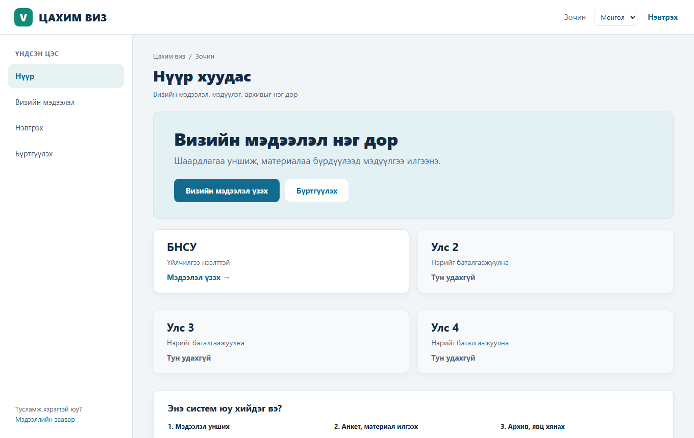 | 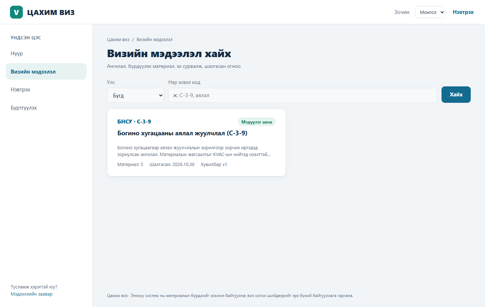 |

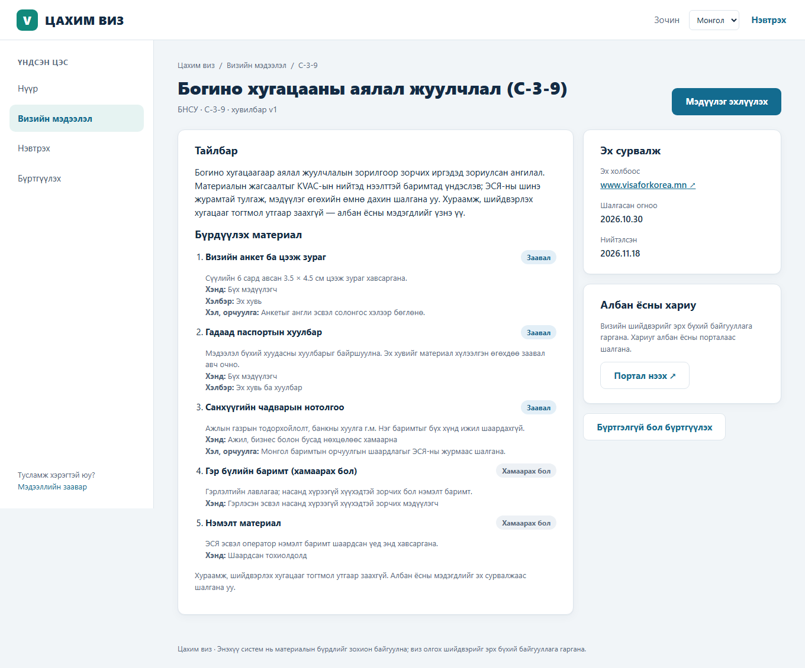

### 1.2 Бүртгүүлэх, нэвтрэх

1. **Бүртгүүлэх** → нэр, имэйл, нууц үг (≥8 тэмдэгт, үсэг + тоо).
2. Имэйлд ирсэн **баталгаажуулах холбоос**-ыг дарна. Баталгаажуулаагүй бол мэдүүлэг илгээх боломжгүй
   (самбар дээр “Дахин илгээх” товч бий).
3. Нууц үгээ мартвал **Нэвтрэх → “Нууц үгээ мартсан уу?”** — 30 минут хүчинтэй холбоос имэйлээр ирнэ.

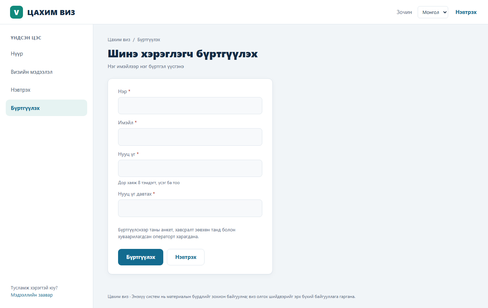

### 1.3 Хянах самбар

Илгээсэн, хянагдаж буй, нэмэлт материал шаардсан мэдүүлгийн тоо, сүүлийн мэдүүлгүүд.

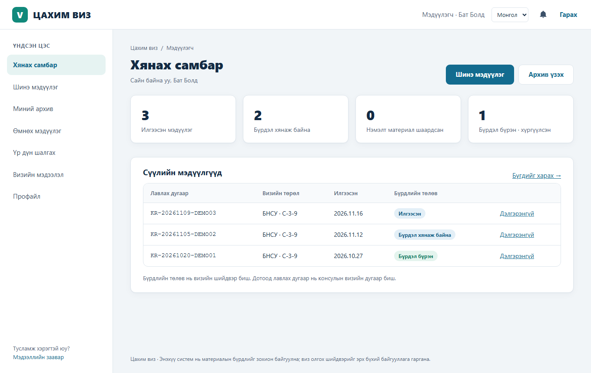

### 1.4 Шинэ мэдүүлэг (3 алхам)

**Алхам 0 — визийн төрөл:** “Шинэ мэдүүлэг” → төрлөө **Сонгох** (“Шаардлага унших”-аар материалын жагсаалтыг дахин харж болно).

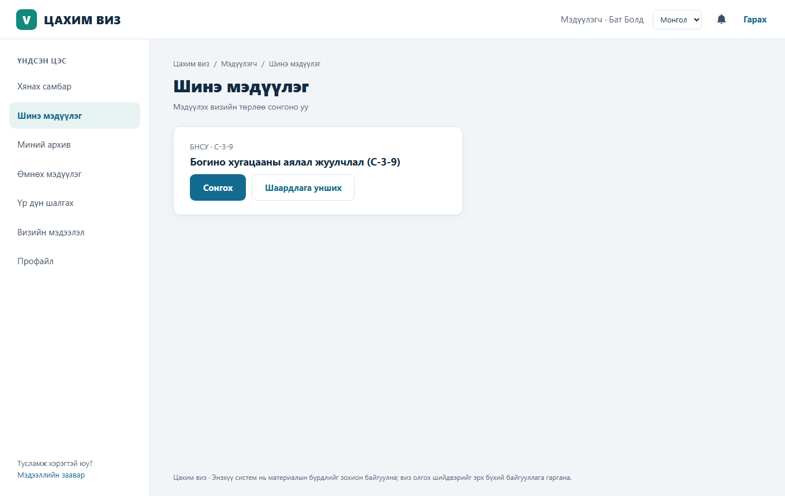

**Алхам 1 — анкет:** нэрийг **паспорт дээрх латин бичгээр**, огноонуудыг паспорт/аяллын төлөвлөгөөтэй тулгаж бөглөнө.
Бичиж байх үед анкет **автоматаар хадгалагдана** (сервер дээр шифрлэгдэнэ) — хөтчөө хаагаад буцаж ороход сэргэнэ.
Интернэт тасарвал анхааруулга гарч, холболт сэргэхэд өөрөө хадгална. Паспортын дугаарыг шифрлэж хадгалдаг.

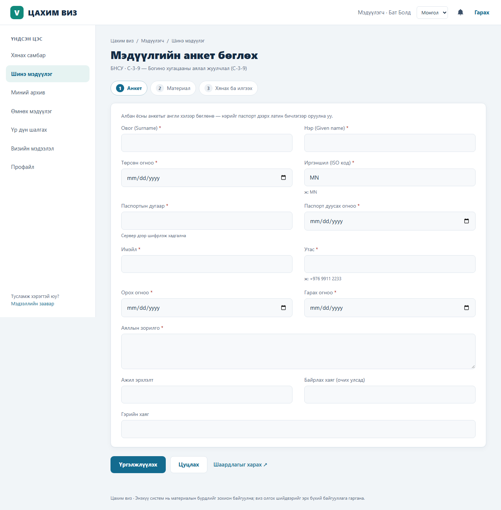

**Алхам 2 — материал:** шаардлага бүрийн хажууд файл хавсаргана.

* Зөвхөн **PDF, JPG, PNG**; нэг файл ≤ **10 MB**, нийт ≤ **100 MB**.
* Файлыг агуулгаар нь шалгадаг — өргөтгөлийг нь сольсон файл хүлээж авахгүй.
* Вирус шалгалт асаалттай бол файл хэдэн секунд “Вирус шалгаж байна” төлөвтэй байна.

**Алхам 3 — хянах ба илгээх:** бүх мэдээллээ нягталж **Илгээх**. Дутуу заавал талбар/материал байвал аль нь дутуу
болохыг харуулна. Илгээсний дараа **лавлах дугаар** (KR-ОООООО-XXXXXX) олгогдож, анкет, материал **архивлагдана —
дахин засах боломжгүй**. Шаардлагатай бол “Мэдээллийг хуулж шинэ мэдүүлэг” үүсгэнэ.

### 1.5 Миний архив ба мэдүүлгийн дэлгэрэнгүй

“Миний архив” — бүх илгээсэн мэдүүлэг, төлөвөөр шүүнэ. Дэлгэрэнгүйд анкет, хавсралт, **бүрдлийн үнэлгээний түүх**
(операторын тайлбартай), албан ёсны үр дүн.

| | |
|---|---|
| 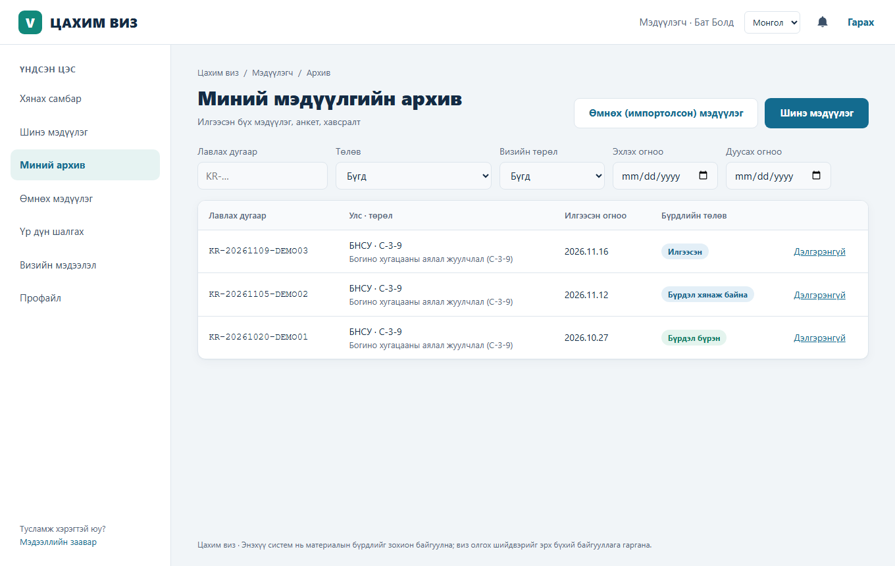 | 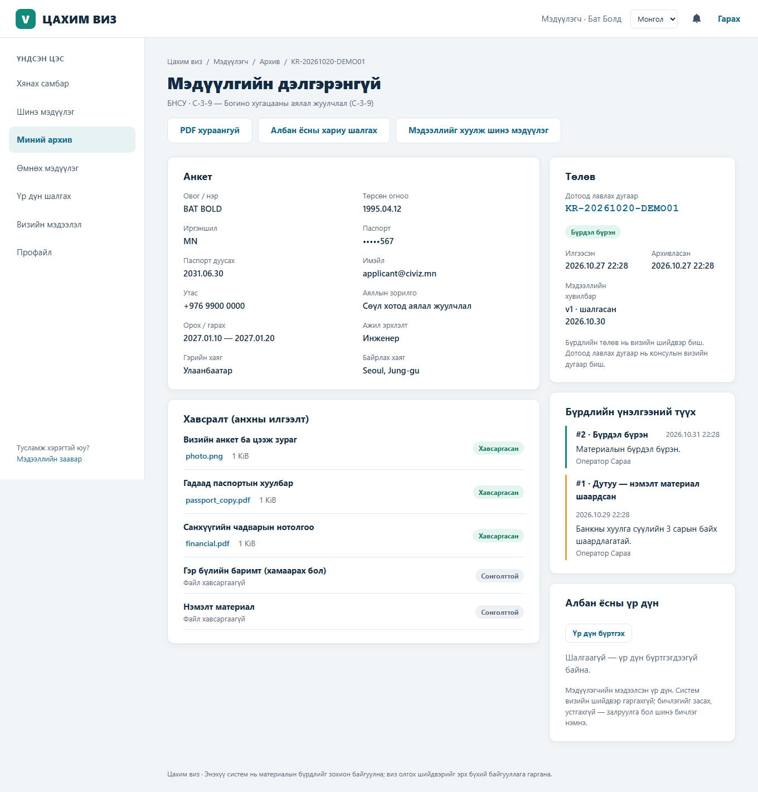 |

* **PDF хураангуй** — анкет, хавсралтын жагсаалт, лавлах дугаартай; хуудас бүрт “АЛБАН БАРИМТ БИШ”, паспорт нууцлагдсан.
* Төлөвүүд:

| Төлөв | Утга | Таны хийх зүйл |
|---|---|---|
| Илгээсэн | Хүлээн авсан, оператор хуваарилагдаагүй | Хүлээнэ |
| Бүрдэл хянаж байна | Оператор материалыг шалгаж байна | Хүлээнэ |
| **Нэмэлт материал шаардсан** (Дутуу) | Операторын тайлбарт юу дутууг бичсэн | Дэлгэрэнгүйгээс **нэмэлт материал илгээх** (анхны илгээлт өөрчлөгдөхгүй, шинэ багц нэмэгдэнэ) |
| Бүрдэл бүрэн | Материал бүрэн — виз гарсан гэсэн үг **биш** | Материалаа ЭСЯ/KVAC-д хүлээлгэн өгөх зааврыг дагана |
| Хүргүүлсэн | Оператор материалыг байгууллагад хүлээлгэн өгсөн огноо, албан дугаартай бүртгэсэн | Албан хариуг порталаас шалгана |

### 1.6 Албан ёсны үр дүн шалгах

**Үр дүн шалгах** → тухайн улсын албан ёсны портал нээгдэнэ (жишээ: БНСУ — visa.go.kr). Порталын нууц үгээ энэ системд
**хэзээ ч** оруулахгүй. Порталаас харсан хариугаа мэдүүлгийн дэлгэрэнгүйд **“Үр дүн бүртгэх”**-ээр (огноо, эх сурвалж,
сонголтоор дэлгэцийн зураг) тэмдэглэж болно — энэ нь таны мэдээлсэн бичлэг, системийн шийдвэр биш.

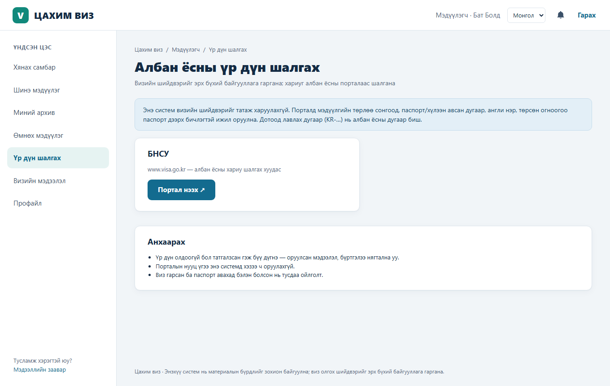

### 1.7 Өмнөх мэдүүлэг

Системээс гадуур өгсөн өмнөх мэдүүлгээ (огноо, төрөл, файл) архивтаа нэмж болно — “импортолсон, баталгаажаагүй”
гэж тэмдэглэгдэнэ, оператор хянахгүй, зөвхөн та харна, устгаж болно.

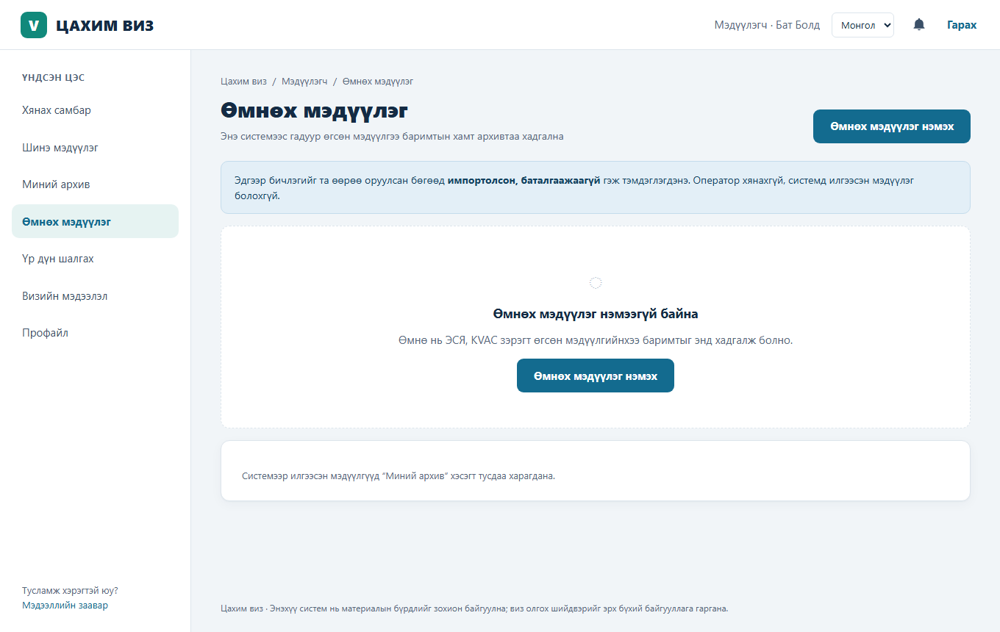

### 1.8 Профайл, хувийн мэдээлэл

* Нэр, нууц үг солих (нууц үг солиход бусад төхөөрөмжөөс гарна).
* **Нэвтэрсэн төхөөрөмжүүд** — нэг бүрчлэн эсвэл бүгдээс гарах.
* **Бүх мэдээллээ татах (ZIP)** — нууц үгээ оруулж анкет, хавсралт, архив, мэдэгдлээ татна.
* **Бүртгэл устгах хүсэлт** — админ баталгаажуулсны дараа анкет, файл бүрмөсөн устна (хянагдаж буй мэдүүлэгтэй бол
  дуустал хүлээнэ).

| | |
|---|---|
| 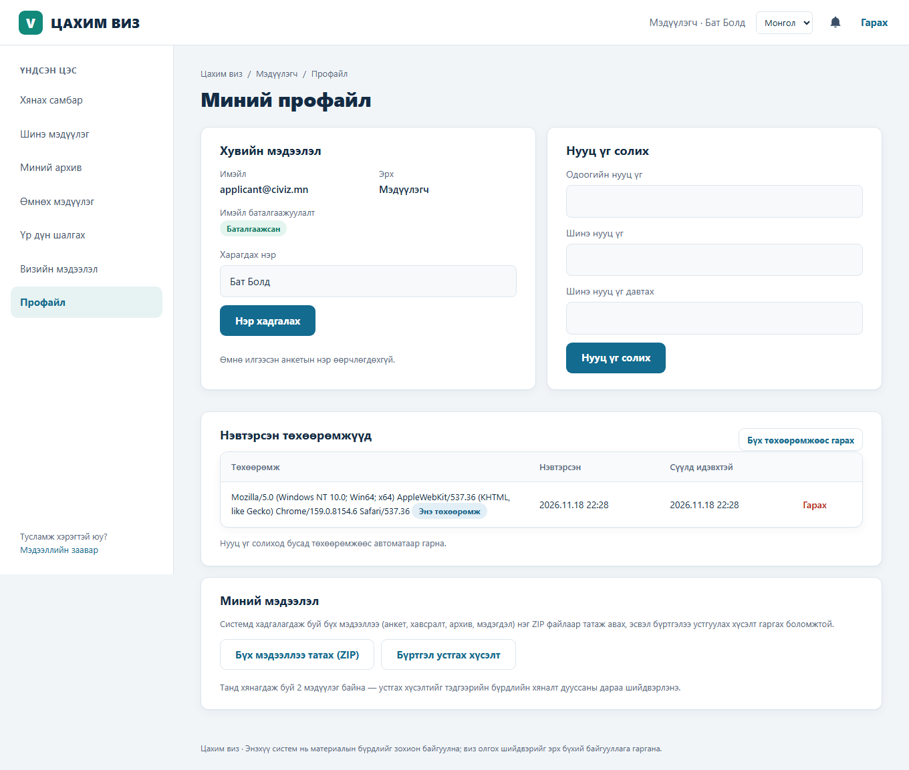 | 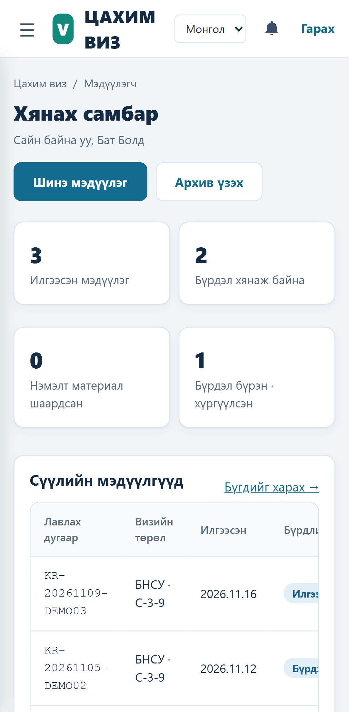 |

---

## 2. Оператор

### 2.1 Нэвтрэх (2FA заавал)

Анх нэвтрэхэд QR код гарна → утсандаа **Google Authenticator** эсвэл **Microsoft Authenticator** суулгаж уншуулна → 6 оронтой
код → **10 нөөц кодыг** хэвлэж/хадгална. Дараагийн нэвтрэлт бүрд апп-ын код асууна. Утсаа гээвэл нөөц кодоор нэвтэрч,
админаар 2FA-г дахин тохируулуулна.

### 2.2 Ажлын жагсаалт

Зөвхөн **танд хуваарилагдсан** мэдүүлэг харагдана. Лавлах дугаар, мэдүүлэгчийн нэрээр хайх, төлөв, сүүлийн үнэлгээ,
илгээсэн огноогоор шүүх, эрэмбэлэх боломжтой. **Шалгах** → мэдүүлэг нээгдэнэ.

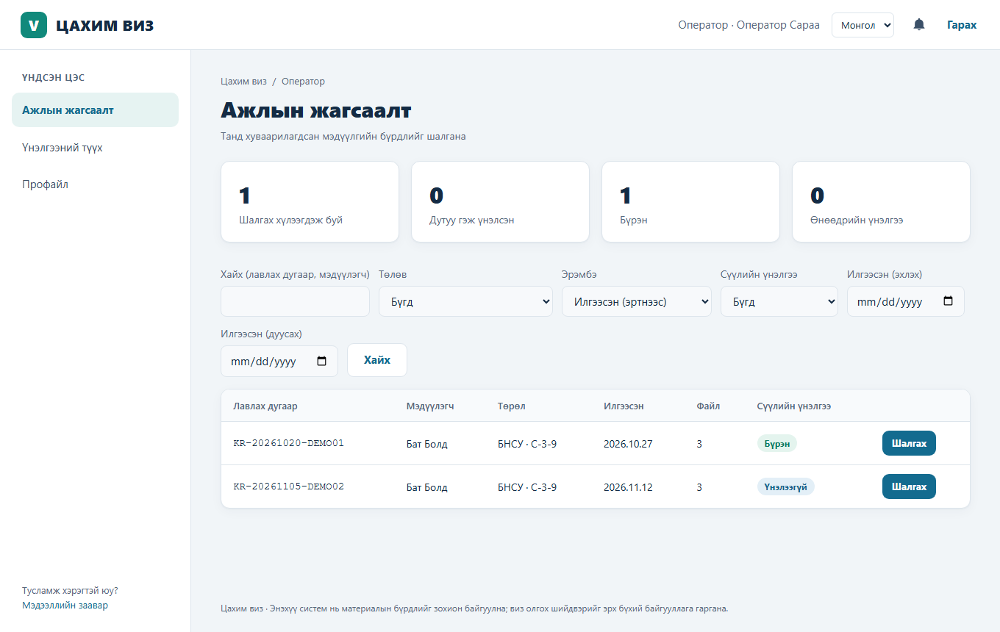

### 2.3 Бүрдэл шалгаж үнэлэх

1. Анкет (паспортын дугаар нууцлагдсан — хавсаргасан хуулбартай тулгана) ба материалыг нэг бүрчлэн нээж шалгана.
2. **Бүрэн** эсвэл **Дутуу** сонгоно. **Дутуу** бол юу дутуу/буруу болохыг **тайлбарт заавал** бичнэ — мэдүүлэгч үүнийг харна.
3. **Үнэлгээ хадгалах.** Хадгалсан үнэлгээг засах, устгах боломжгүй; алдаа гарвал шинэ үнэлгээ нэмнэ.
4. Мэдүүлэгч нэмэлт материал илгээвэл мэдэгдэл ирж, жагсаалтад дахин гарна — шинэ багцыг шалгаад дахин үнэлнэ.

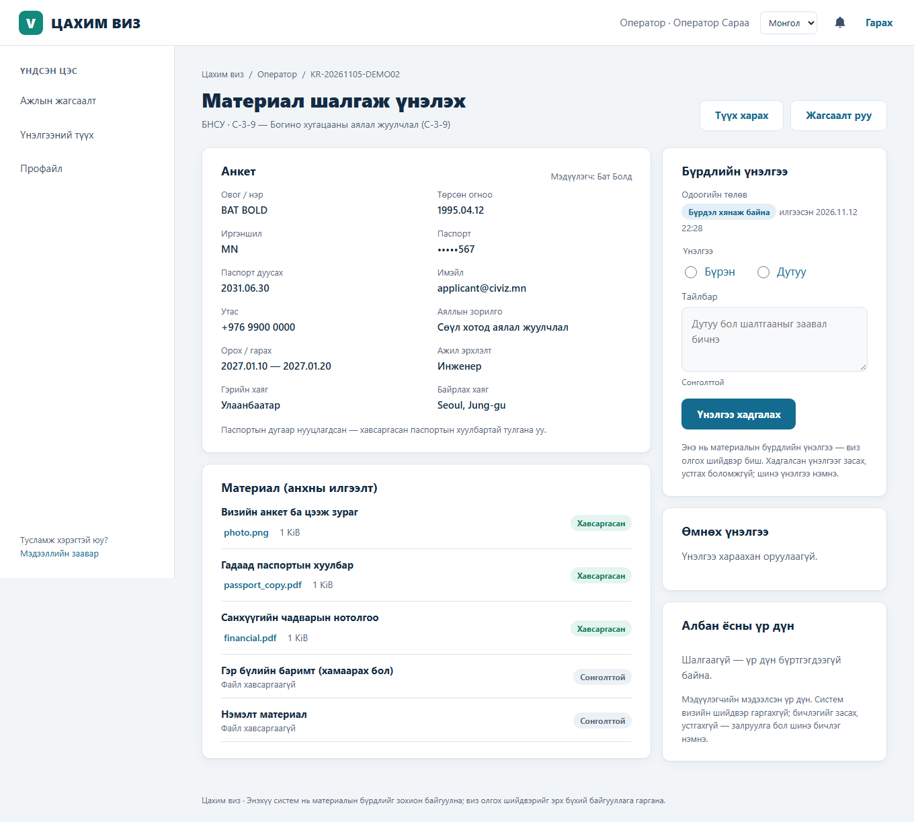

> Та **визийн шийдвэр** гаргахгүй — “зөвшөөрсөн/татгалзсан” гэж бичихгүй. Зөвхөн материалын бүрдлийг үнэлнэ.

Бусад үйлдэл (мэдүүлгийн дэлгэрэнгүйд):

* **Хүргүүлсэн бүртгэх** — “Бүрдэл бүрэн” материалыг ЭСЯ/KVAC-д хүлээлгэн өгсний дараа байгууллага, албан дугаар, огноо,
  нотолгоо файлтай нэг удаа бүртгэнэ.
* **Албан үр дүн тулгах** — мэдүүлэгч нотолгоотой үр дүн бүртгэсэн бол нотолгоог шалгаж “Таарч байна / Таарахгүй” гэж
  тусдаа тэмдэглэнэ (мэдүүлэгчийн бичлэг өөрчлөгдөхгүй).

### 2.4 Үнэлгээний түүх

Таны хийсэн бүх үнэлгээ.

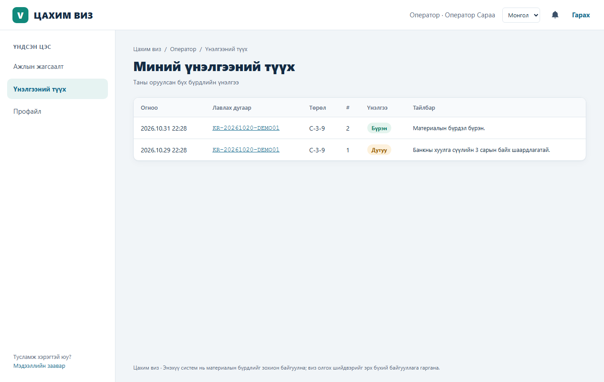

---

## 3. Админ

Админ нь лавлах мэдээлэл, хэрэглэгч, хуваарилалтыг удирдана. **Админ эрхээр мэдүүлэгчийн анкет, хавсралтыг үзэх
боломжгүй** (хувийн мэдээллийн хамгаалалт).

### 3.1 Самбар

Хуваарилаагүй, хянагдаж буй мэдүүлэг, операторын ачаалал, сүүлийн үйлдлүүд.

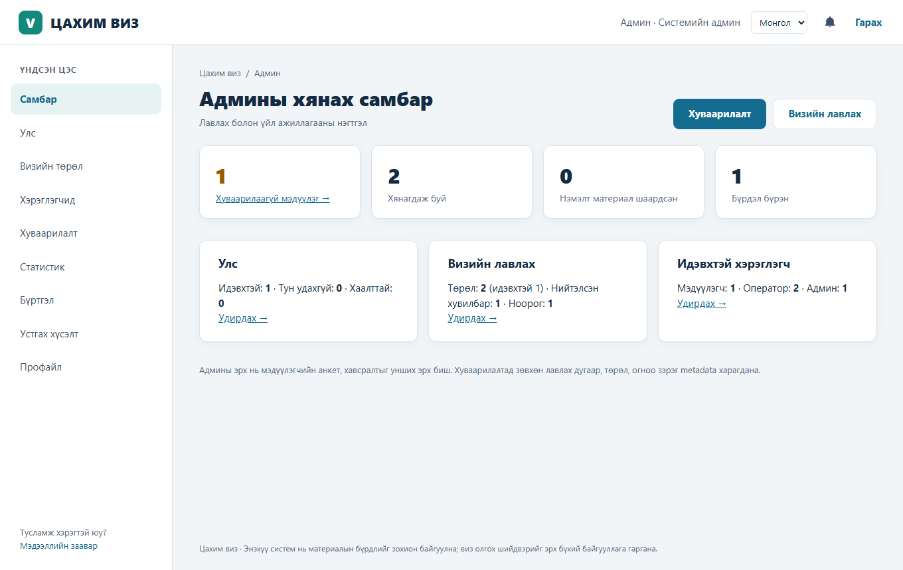

### 3.2 Хуваарилалт

**Хуваарилалт** → “Хуваарилаагүй” шүүлт → мэдүүлэг бүрд оператор сонгож **Хуваарилах**. Олон мэдүүлгийг чагтлаад нэг
дор (≤100) хуваарилж болно — аль нэг нь энэ хооронд өөр хүнээр өөрчлөгдсөн бол бүгд цуцлагдаж, зөрсөн дугааруудыг
харуулна. Дахин хуваарилах, цуцлах мөн энд.

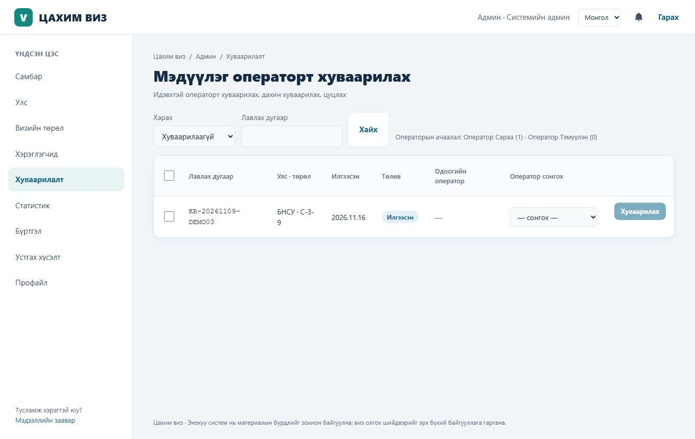

### 3.3 Лавлах мэдээлэл (улс, визийн төрөл, хувилбар)

1. **Улс** — шинэ улс нэмэх, “Тун удахгүй / Идэвхтэй / Идэвхгүй”, албан үр дүнгийн портал холбоос.
2. **Визийн төрөл** → **Хувилбарууд** → **Шинэ хувилбар**: нэр, тайлбар, **эх сурвалжийн холбоос**, **шалгасан огноо**,
   шаардлагатай материалууд (заавал эсэх, хэнд хамаарах, эх/хуулбар, орчуулга).
3. **Нийтлэх** — эх сурвалж, шалгасан огноо, дор хаяж нэг шаардлагагүй бол нийтлэхгүй. Нийтэлсэн хувилбарыг засахгүй —
   журам өөрчлөгдвөл **хуулж шинэ хувилбар** үүсгээд нийтэлнэ. Өмнө илгээсэн мэдүүлгүүд хуучин хувилбартайгаа үлдэнэ.

> Хураамж, шийдвэрлэх хугацаа, шаардлагыг **зохиож бичихгүй** — зөвхөн албан эх сурвалжаас, холбоос, огноотой нь.

| | |
|---|---|
| 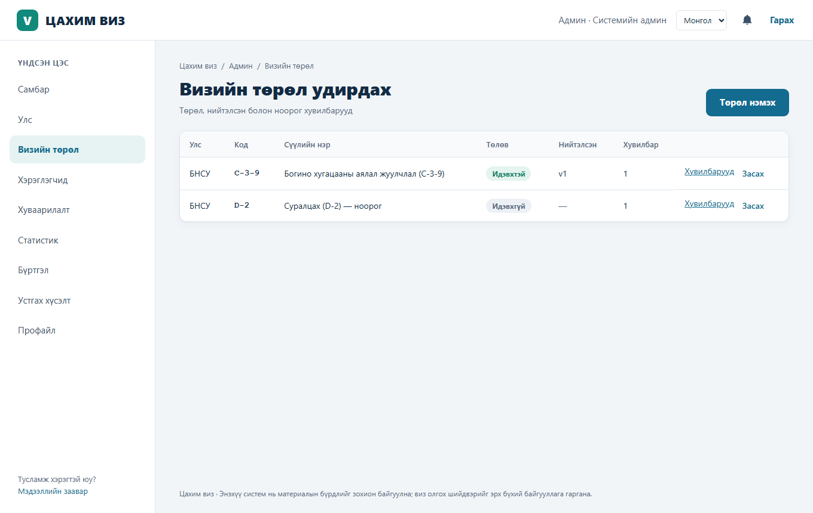 | 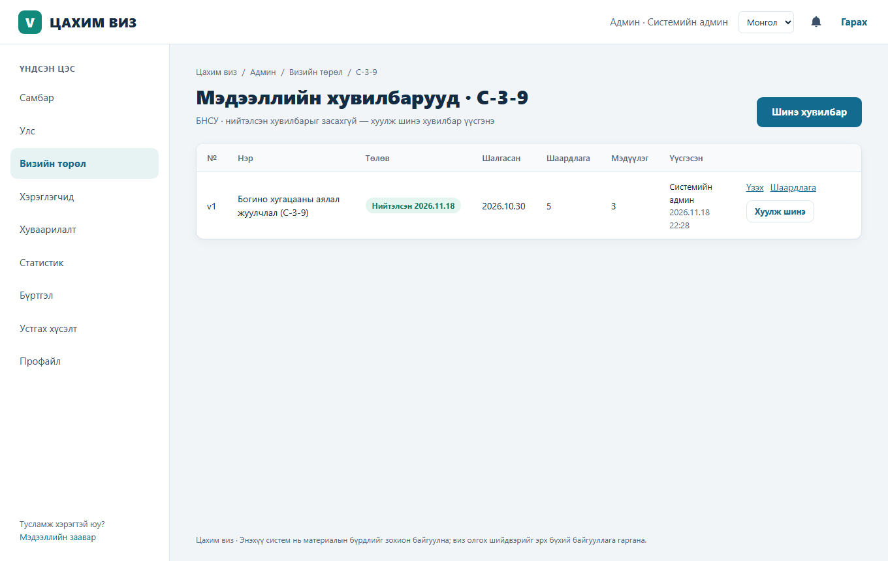 |

### 3.4 Хэрэглэгчид

Оператор/админ үүсгэх (анхны нууц үгийг та тавьж, ажилтанд найдвартай замаар дамжуулна — ажилтан нэвтэрмэгц сольж, 2FA тохируулна), идэвхгүй болгох (бүх сесс нь хаагдана), **2FA дахин тохируулах**
(утсаа гээсэн ажилтанд; өөрийнхийгөө өөр админаар хийлгэнэ).

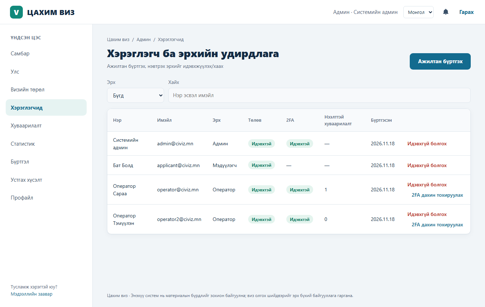

### 3.5 Статистик, бүртгэл, устгах хүсэлт

* **Статистик** — долоо хоног/сараар илгээлт, эхний үнэлгээ хүртэлх хугацаа (медиан, 90%), операторын ачаалал. Зөвхөн
  нэгтгэсэн тоо; хувийн мэдээлэл агуулахгүй. График бүрийг “Хүснэгтээр харах” боломжтой.
* **Бүртгэл (audit)** — хэн, хэзээ, ямар үйлдэл хийсэн (агуулгагүй).
* **Устгах хүсэлт** — мэдүүлэгчийн бүртгэл устгах хүсэлтийг баталгаажуулах/татгалзах.

| | |
|---|---|
| 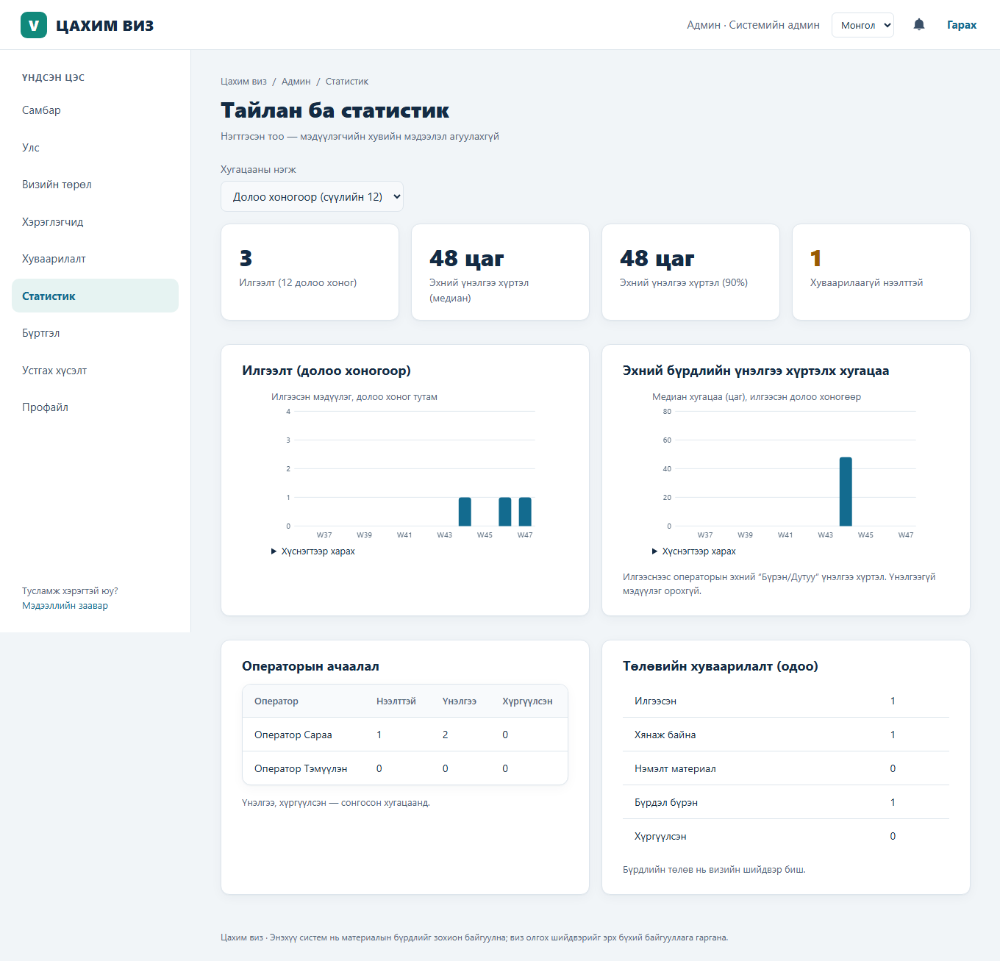 | 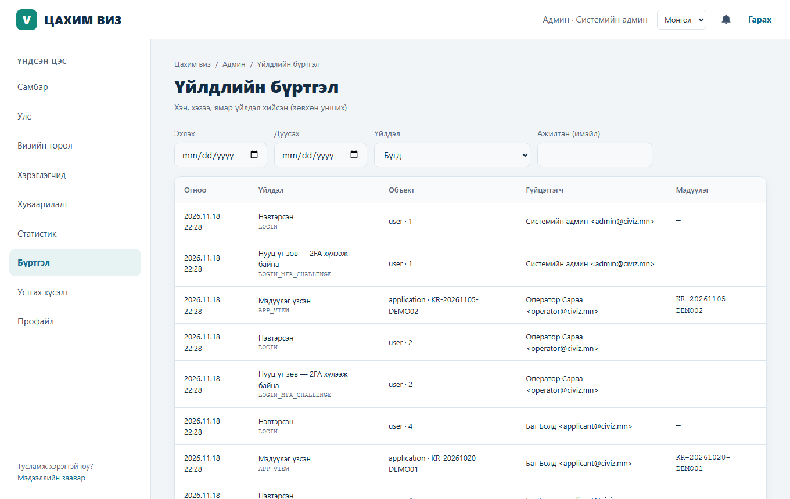 |

---

## 4. Түгээмэл асуулт

| Асуулт | Хариулт |
|---|---|
| Илгээсэн мэдүүлгээ засаж болох уу? | Үгүй. “Дутуу” гэж үнэлэгдвэл нэмэлт материал илгээнэ; эсвэл “Мэдээллийг хуулж шинэ мэдүүлэг”. |
| “Бүрдэл бүрэн” = виз гарсан уу? | Үгүй. Материал бүрэн гэсэн үг. Визийн хариуг албан порталаас шалгана. |
| Баталгаажуулах имэйл ирэхгүй байна | Spam хавтсаа шалгах; самбараас “Дахин илгээх” (цагт 3 удаа). |
| “Нэвтрэх хугацаа дууссан” | Нэвтэрснээс 8 цагийн дараа сесс дуусна — дахин нэвтэрнэ; бичиж байсан анкет автоматаар хадгалагдсан. |
| Файл “хүлээн авах боломжгүй” | Зөвхөн PDF/JPG/PNG, ≤10 MB; скан хийсэн зургийг PDF болгож хэмжээг багасгах. |
| 2FA кодоо оруулж чадахгүй (ажилтан) | Утасны цаг автоматаар тохируулагдсан эсэхийг шалгах; нөөц код ашиглах; админд хандах. |

Дэлгэцийн зургийг шинэчлэх (хөгжүүлэгчид): `cd client && npm run build && cd .. && npm run docs:screenshots`.
